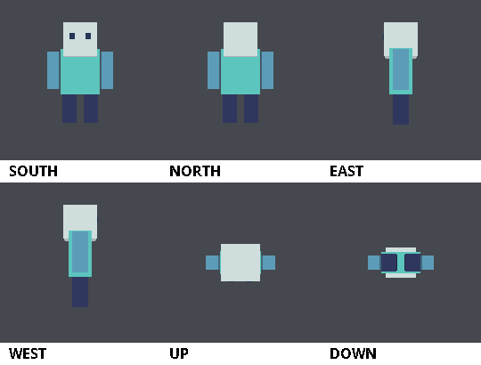

# HoloMapPerspective

**Minecraftの地図を、見る人の位置に合わせて映像が変わる3DディスプレイにするPaperプラグインです。**

額縁に入れた地図へ3Dモデルを描画し、プレイヤーが移動すると、その位置から見たモデルの姿に更新します。同じ展示を複数人で見ても、それぞれの視点に合った映像が表示されます。クライアント側のMODは不要です。

壁に設置する「モデルをのぞく窓」と、周囲から眺められる立方体・直方体の展示を作れます。サーバー内の展示室や、建築・キャラクターモデルのプレビューに利用できます。



*描画処理で生成した6面への投影例。*

## 主な機能

- **プレイヤーごとの視差表示**：立ち位置に合わせて、モデルの見える角度が変わります。
- **壁面・6面ディスプレイ**：壁面は最大3×3枚の地図、6面表示は各軸の長さを指定した直方体に対応します。
- 外部モデルはOBJを読み込めます。GPU方式では、FBXやBlenderから変換したテクスチャ付きアニメーションもループ再生できます。
- **GPU描画**：サーバーと同じPCで動くPython・OpenGLを使い、3Dモデルを描画します。テクスチャ付きの専用モデル形式にも対応します。
- **内蔵デモ**：外部モデルを用意せず、動く`demo`モデルで表示を試せます。

## 動作環境

現在のバージョンは **0.7.3** です。ソースからビルドして導入します。

| 項目 | 必要な環境 |
| --- | --- |
| サーバー | Minecraft Java Edition / Paper **26.3** |
| Java | **JDK 25** |
| Python | サーバーと同じPCのPython 3 |
| Pythonライブラリ | ModernGL・Pillow（[gpu-requirements.txt](gpu-requirements.txt)） |
| GPU | OpenGL 3.3に対応したGPUとドライバ |

ビルド対象はPaper API `26.3.build.243-stable`です。既存の検証環境はWindows 11・JDK 25・Paper 26.3 build 243・NVIDIA RTX 3050です。

GPU方式を標準で使用します。CPU方式も選択できますが、OBJは1ファイル10MBまでで、更新頻度は最大20回/秒です。

## 導入

以下はWindows PowerShellでの手順です。先にPaper 26.3のサーバーを起動できる状態にしてください。JDK 25とPython 3をインストールし、`JAVA_HOME`がJDK 25を指すように設定します。

### 1. ソースを取得してビルドする

```powershell
git clone https://github.com/tomikan1208-code/HoloMapPerspective.git
cd HoloMapPerspective
python -m pip install -r gpu-requirements.txt
.\gradlew.bat build
```

`build/libs/HoloMapPerspective-0.7.3.jar`が生成されます。

ソースをZIPで取得した場合も、展開したフォルダでライブラリのインストールとビルドを実行できます。

### 2. Paperサーバーへ配置する

1. サーバーを停止し、JARをサーバーの`plugins/`へコピーします。
2. サーバーを起動すると、設定やモデル用のフォルダが`plugins/HoloMapPerspective/`に生成されます。
3. ゲーム内で`/holomap status`を実行して、GPUが`READY`になっていることを確認します。サーバーコンソールでは先頭の`/`を省略します。

`py -3`でPythonを起動する環境では、`py -3 -m pip install -r gpu-requirements.txt`を使います。生成された`plugins/HoloMapPerspective/config.yml`で`gpu-python-command: "py -3"`を設定し、サーバーを再起動してください。

### 3. 内蔵デモを表示する

操作には**OP権限**または`holomap.admin`権限が必要です。

1. 展示場所の周囲と上に、額縁を含めて設置できる空間を確保します。
2. 12ブロック以内にある地面のブロックの**上面**へ照準を合わせます。
3. 次のコマンドで2×2×2のディスプレイを作成します。

   ```text
   /holomap cube 2 2 2 demo
   ```

4. 展示の外側を歩き、立ち位置によってモデルの見え方が変わることを確認します。

初回のモデル準備中は、`/holomap status`で進行状況を確認できます。

壁面に表示する場合は、地図の左下にしたい壁ブロックを向いて、次のコマンドを実行します。

```text
/holomap place 2 2 demo
```

## コマンド

`<...>`は必須、`[...]`は省略可能な引数です。モデル名を省略すると`demo`を使用します。`/hmap`も`/holomap`の別名として使えます。

| コマンド | 内容 |
| --- | --- |
| `/holomap help` | コマンドのヘルプを表示 |
| `/holomap cube <X> <Y> <Z> [model]` | 見ている地面の上に6面ディスプレイを設置 |
| `/holomap place [width] [height] [model]` | 見ている壁にディスプレイを設置。幅・高さの既定値は各1 |
| `/holomap create <world> <x> <y> <z> <X> <Y> <Z> [model]` | 座標を指定して6面ディスプレイを設置。コンソールからも実行可能 |
| `/holomap list` | 設置済みディスプレイとIDを表示 |
| `/holomap models` | 利用できるモデル名を表示 |
| `/holomap model <id> <name>` | 指定したディスプレイのモデルを変更 |
| `/holomap fill <id> [solid\|shell\|empty]` | 設置済みの6面ディスプレイのブロック配置を変更。省略時は`cube-fill`の設定を適用 |
| `/holomap lock <id> [on\|off]` | 額縁の保護を切り替え。省略時は現在の状態を表示 |
| `/holomap remove <id>` | 指定したディスプレイを撤去 |
| `/holomap status` | GPUとモデルの準備状況、描画・地図送信処理の時間を表示 |
| `/holomap reload` | 設定とモデルを再読み込み |

6面表示の`X / Y / Z`は、幅（+X）・高さ（+Y）・奥行き（+Z）のブロック数です。

必要な地図は`2 × (X×Y + Y×Z + Z×X)`枚で、2×2×2なら24枚になります。軸の長さと地図の総数には設定上の上限があります。

設置直後の額縁は保護されています。プレイヤーによる地図の回転・取り外しや額縁の破壊を許可する場合は`/holomap lock <id> off`を使います。

## モデルを追加する

### 静止モデル

`plugins/HoloMapPerspective/models/<モデル名>/`へ`model.obj`を配置します。MTLを使う場合は、OBJの`mtllib`で指定した名前で同じフォルダに置いてください。

モデル名には半角英数字・`_`・`-`を1～40文字で使用できます。

同梱の[crystalサンプル](examples/models/crystal)を試す場合は、フォルダごと次の場所へコピーします。

```text
plugins/HoloMapPerspective/
└─ models/
   └─ crystal/
      ├─ model.obj
      └─ crystal.mtl
```

コピー後、設定とモデルを再読み込みし、表示を切り替えます。`1`は`/holomap list`で確認したディスプレイIDへ置き換えてください。

```text
/holomap reload
/holomap models
/holomap model 1 crystal
```

通常のOBJ読み込みでは、形状とMTLの拡散色（`Kd`）を使用します。画像テクスチャ（`map_Kd`）は読み込みません。

### FBX・Blenderのアニメーション（GPU方式）

BlenderでFBXの動きを評価し、[export_hanim.py](tools/export_hanim.py)で`model.hanim`に変換します。面のインデックス・UV・材質を共有し、各フレームは16ビットに量子化した頂点位置を圧縮して保存します。Paperサーバーではその時刻に必要な姿勢を展開します。

```powershell
blender -b --python-exit-code 1 -P tools/export_hanim.py -- --fbx "clip.fbx" --output "myclip"
blender -b "scene.blend" --python-exit-code 1 -P tools/export_hanim.py -- --output "myclip"
```

出力先には新しいフォルダ名を指定します。FBXは読み込み後に有効なアクションの範囲、`.blend`はシーンの開始・終了フレームを使います。`--start`と`--end`で範囲を指定でき、`--step 2`を指定すると60 fpsの素材を30 fpsで書き出せます。Sparxieのように中間シェイプを含むFBXの読み込みはBlender 5.2.3のFBXインポーターで確認しています。

テクスチャにはPrincipled BSDFのベースカラーに直接つないだ画像を使います。材質が抜けたメッシュには、既存UVに合う画像を`--texture "Face=face.png"`のように指定できます。ベースカラー画像のアルファは、元の材質でアルファが接続されている場合に使います。書き出す範囲で頂点の接続・UV・材質の割り当てが一定である必要があります。補助メッシュを外すには`--exclude "メッシュ名"`を指定します。

生成されたフォルダを`plugins/HoloMapPerspective/models/`へコピーします。`model.hanim`と`textures/`がある場合は一緒に配置してください。GPU方式では同じモデルフォルダの連番OBJや静止モデルより`model.hanim`を優先し、ファイルに保存されたサンプルレートでループします。配置後に`/holomap reload`を実行し、`/holomap cube 2 4 2 myclip`で表示できます。

### 連番OBJ

`models/<モデル名>/frames/`へ、`0000.obj`、`0001.obj`のように桁数をそろえた連番OBJを配置します。ファイル名順にループし、再生速度は`animation-fps`で指定します。初期設定では最大120フレームです。Blenderからは[export_obj_animation.py](tools/export_obj_animation.py)で書き出せます。

### テクスチャ付きモデル（GPU方式）

PMXモデルは[prepare_pmx.py](tools/prepare_pmx.py)で静止モデルへ変換できます。このツールにはNumPyとPillowが必要です。

生成された次のファイルを、同じモデルフォルダへ配置します。

```text
models/<モデル名>/
├─ model.hmesh
├─ model.hmesh.materials.json
└─ textures/
```

GPU方式では、`frames/`がない場合、`model.hmesh`を`model.obj`より優先します。

専用形式`HMAPTEX1 / HMAPTEX2`は画像テクスチャに対応します。PMXから生成する`HMAPTEX2`では、法線・トゥーン／スフィアテクスチャ・輪郭線・半透明材質も使用します。

## 設定

設定ファイルは`plugins/HoloMapPerspective/config.yml`です。変更後は`/holomap reload`で読み直します。

| 設定 | 初期値 | 内容 |
| --- | --- | --- |
| `renderer-backend` | `gpu` | 描画方式。`cpu`で小規模OBJ向けのCPU方式を選択 |
| `gpu-python-command` | `python` | GPU描画に使うPythonコマンド |
| `render-fps` | `60` | 描画・地図送信の目標更新頻度 |
| `animation-fps` | `60` | 連番OBJの再生速度 |
| `view-distance` | `16.0` | 描画対象とする距離（ブロック） |
| `cube-material` | `AIR` | 6面ディスプレイのブロック材質。 `AIR`では額縁だけを設置 |
| `cube-fill` | `shell` | ブロックの配置。`shell`は外周1ブロック、`solid`は全体、`empty`は額縁だけ |
| `cube-inward` | `true` | 地図を内向きにし、視点から見て奥の面へ投影 |
| `cube-glow` | `true` | 発光額縁で暗い場所でも色を保つ |
| `max-prism-axis` | `8` | 6面ディスプレイの各軸の長さの上限 |
| `max-prism-maps` | `96` | 6面ディスプレイ1つに使う地図枚数の上限 |
| `max-obj-bytes` | `1500000000` | GPU方式で読み込むOBJの1ファイルあたりの容量上限 |
| `max-triangles` | `3000000` | モデル1フレームあたりの三角形数の上限 |
| `max-animation-frames` | `120` | 連番OBJのフレーム数の上限 |
| `max-packed-animation-frames` | `3600` | GPU用`model.hanim`のフレーム数の上限 |

すべての初期設定は[config.yml](src/main/resources/config.yml)で確認できます。

`cube-material`・`cube-inward`・`cube-glow`の変更は、新しく設置する6面ディスプレイに適用されます。内向き投影には`AIR`または`BARRIER`を使用してください。

内向きの展示で`cube-material: BARRIER`と`cube-fill: shell`を組み合わせると、地図の1ブロック外側に支えが付きます。たとえば2×4×2の展示は、支えを含めると4×6×4になります。

大きいモデルはバックグラウンドで変換し、`gpu-cache/`へ保存します。初回の準備には時間と空き容量が必要です。容量上限と三角形数上限は別の制限で、上限を増やすほどメモリ・VRAMや描画処理への負荷も大きくなります。

## 表示の仕組みと制約

モデルの画像をサーバーで計算し、Minecraftの地図色へ変換してプレイヤー別に送ります。地図1枚の解像度は128×128ピクセルです。

実際の3Dメッシュをクライアントへ送る方式ではないため、雨や他の物体との前後関係は完全には一致しません。6面表示は展示空間の外側から眺める使い方を想定しています。

対応するPaper 26.3環境のGPU方式では、描画と送信を20TPSの処理から分離し、**最大60回/秒の更新を目標**にします。実際の速度はモデルの複雑さ・地図枚数・展示数・視聴人数・通信帯域で変わり、クライアントの表示60fpsを保証するものではありません。

CPU方式とBukkit経由の送信では最大20回/秒です。移動中には視点の取得・描画・通信による遅れも残ります。

GPU方式では、モデルの投影範囲から空白と判断できる面の描画を省き、小さく映る面では必要な範囲だけを読み戻します。`/holomap status`では直近のキュー待ち、GPU描画と画像受信、地図色変換、差分生成、パケットの生成と引き渡しにかかった時間を確認できます。

- [GPU・Paperでの検証記録（0.6.0）](docs/gpu-0.6.0-verification.md)
- [バージョンごとの変更履歴](CHANGELOG.md)

## トラブルシューティング

まず`/holomap status`でGPUとモデルの状態を確認してください。GPUの起動・描画エラーは`plugins/HoloMapPerspective/gpu-renderer.log`に記録されます。

| 症状・メッセージ | 確認すること |
| --- | --- |
| `ModuleNotFoundError: moderngl`など | `gpu-python-command`と同じPython環境へ、`gpu-requirements.txt`のライブラリをインストールしてください。 |
| `Hardware GPU unavailable` | GPUドライバと実行環境を確認してください。GPUのないVPSやソフトウェアOpenGLは、標準設定のGPU方式では利用できません。 |
| モデルが表示されない | モデル名・配置場所と`/holomap status`を確認してください。初回変換中は準備の完了を待ち、`FAILED`の場合は表示された理由を確認します。 |
| `OBJ exceeds max-triangles` | モデルを軽量化するか、環境に合わせて`max-triangles`を調整してください。`max-obj-bytes`の変更だけでは解決しません。 |
| 設置時に`Prism needs empty space`が出る | 展示本体と6面の額縁の設置場所を空けてください。既存の額縁などとの重なりも確認します。 |
| 更新が遅い・負荷が高い | 地図枚数、モデルの三角形数、同時表示数、`render-fps`を減らして確認してください。 |

## 更新する場合

ワールド・`config.yml`・`displays.yml`・`models/`をバックアップし、古いJARを`plugins/`の外へ移してから新しいJARを配置してください。

`gpu/renderer.py`は起動時に同梱版で上書きされます。独自に変更している場合は、更新前に保存しておいてください。
